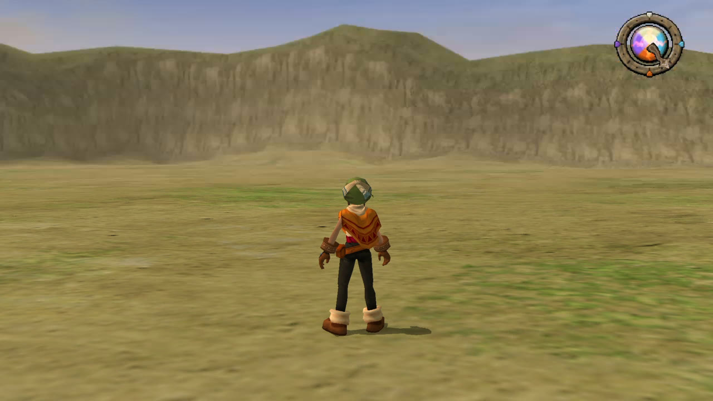
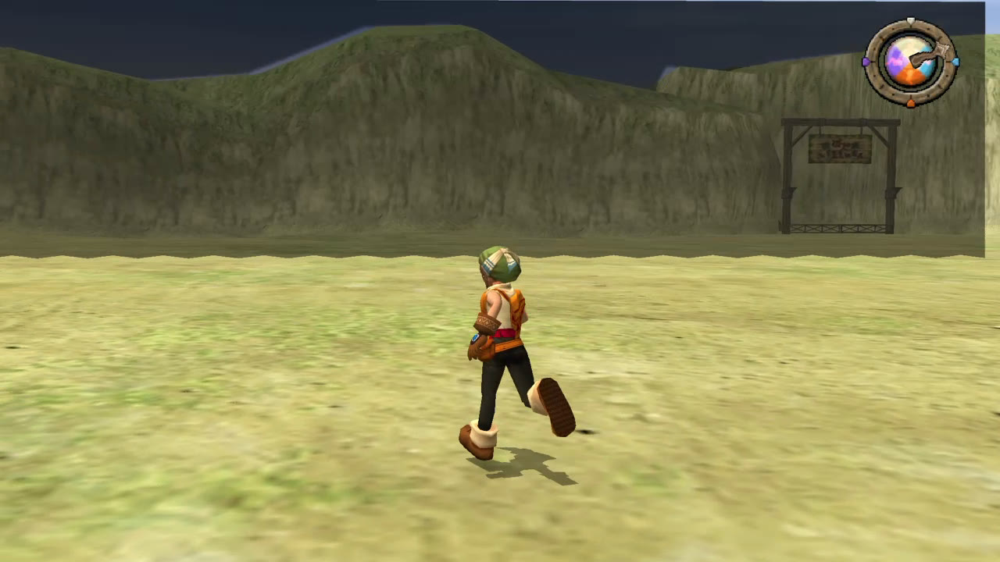
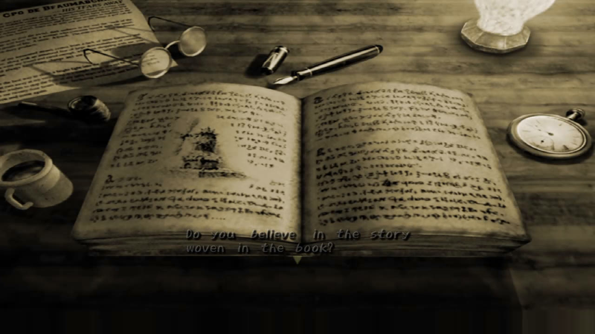
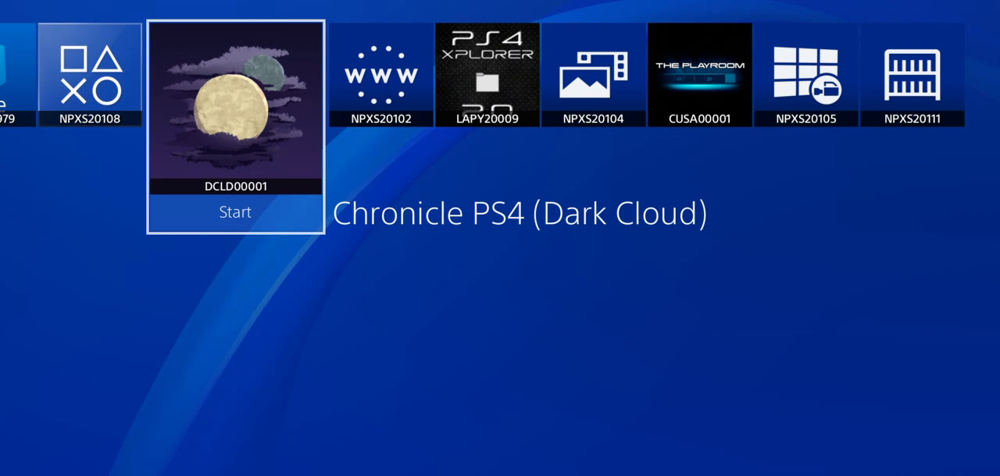

# Chronicle PS4 (Dark Cloud)

**Play Dark Cloud on your jailbroken PS4.** A native port, not an emulator: 1080p, 60 frames a second.

## [⬇ Download the latest release](https://github.com/odiecay/chronicle-ps4/releases/latest)

[Watch it running](https://www.youtube.com/watch?v=EqCQ85O4dbw)

| | |
|---|---|
|  |  |
|  |  |

## Install in three steps

You need a PS4 with [GoldHEN](https://github.com/GoldHEN/GoldHEN), your own Dark Cloud (USA) disc image as an `.iso`, and a USB drive.

1. On the USB drive, make a folder called **`darkcloud`** and put your `.iso` in it. Put `Chronicle-PS4-v0.1.0.pkg` (from the download) in the drive's main folder.
2. Plug the drive into the PS4 and install the package with GoldHEN's **Package Installer**.
3. Start **Chronicle PS4 (Dark Cloud)** from the home screen and leave the drive plugged in.

The game sets itself up from your disc image. A few minutes later it says it's ready: press **X** and play. You only do this once.

**Need more?** [Full install guide](ps4/docs/INSTALL.md), with the FTP route and fixes for common problems.

## Good to know

* **No game data is included.** You bring your own disc image.
* Tested on firmware 13.52 with the **USA NTSC 1.02** disc. Other discs haven't been tried on a console.

Your saves live in `/data/darkcloud/save` and stay on the console, including when you update.

## For developers

Everything needed to build the package is in this one repository, including the renderer, and a plain `git clone` is enough. The build steps, tested on a fresh clone, are in **[`ps4/docs/BUILDING.md`](ps4/docs/BUILDING.md)**. How the port is put together, the options and the measurements are in [`ps4/README.md`](ps4/README.md). The original Chronicle readme is [`README-CHRONICLE.md`](README-CHRONICLE.md).

## Credits

* The **Chronicle** team ([TheMoonPeople](https://github.com/TheMoonPeople)) for the Dark Cloud decompilation and the Kazarov build system (MIT, in `tools/kazarov`). This port stands on their work.
* **Level-5** made Dark Cloud. This project is not affiliated with them.
* The **Ship of Harkinian PS4 port** showed how to do native PS4 homebrew with Piglet.
* [OpenOrbis](https://github.com/OpenOrbis/OpenOrbis-PS4-Toolchain) and [GoldHEN](https://github.com/GoldHEN/GoldHEN).
* **FlameCheese** for the 8-bit Dark Cloud remixes played during setup.

The PS4 layer in `ps4/` is MIT ([`ps4/LICENSE-ps4-port`](ps4/LICENSE-ps4-port)). Chronicle and Kazarov keep their own terms.
